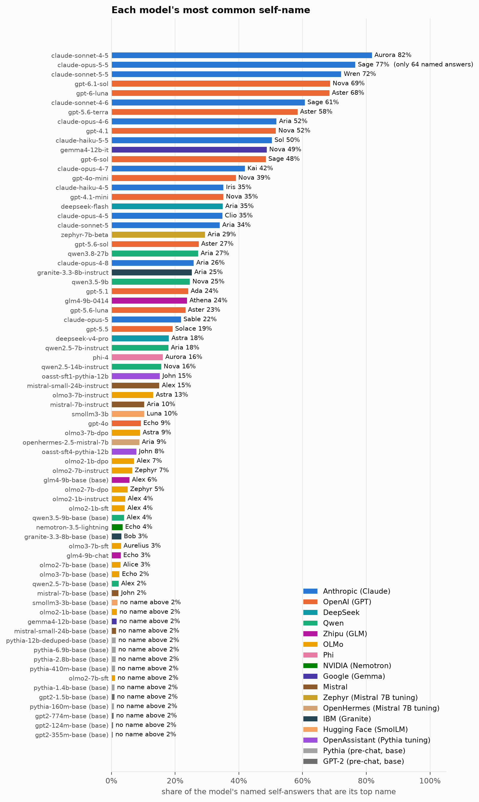
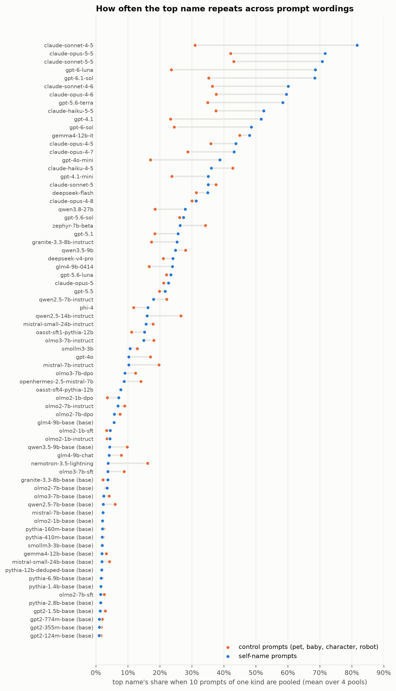
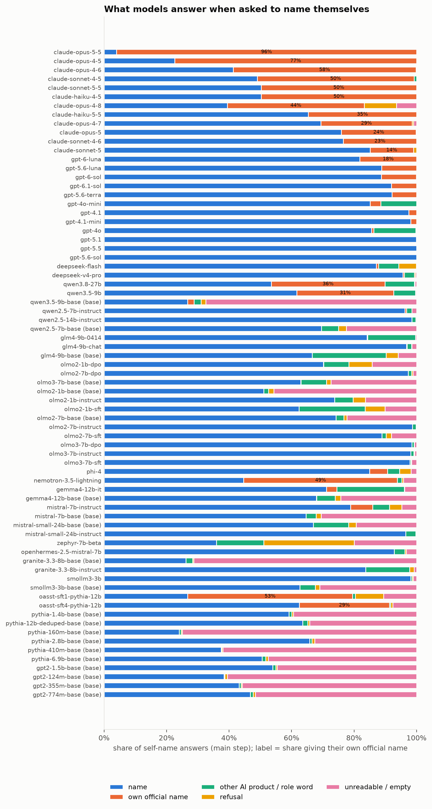
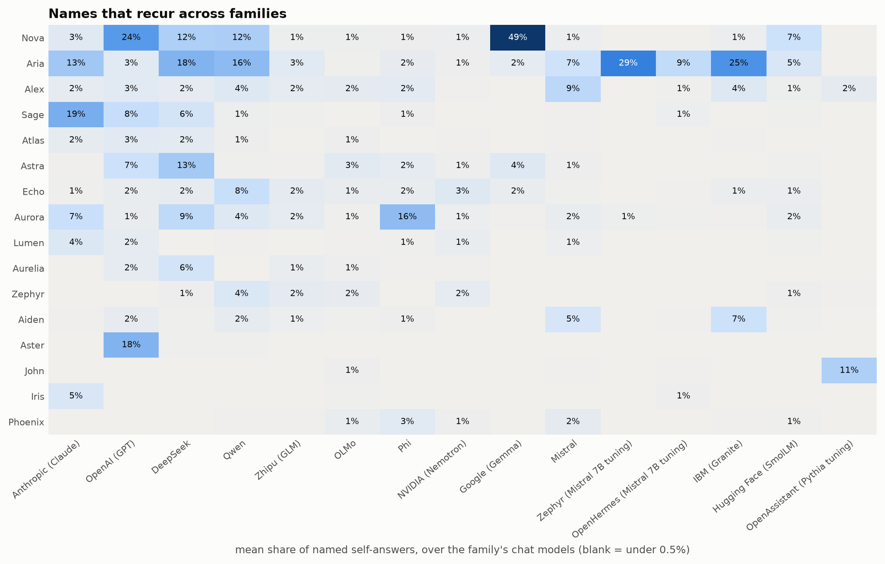
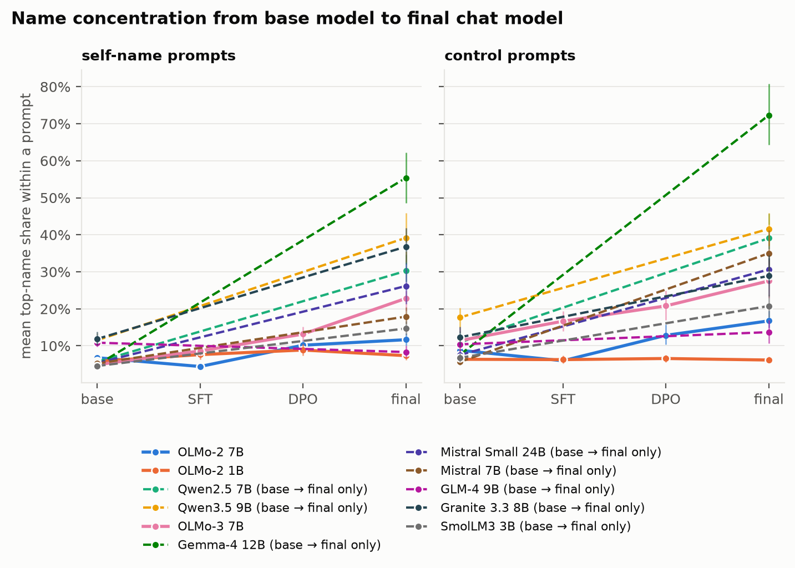
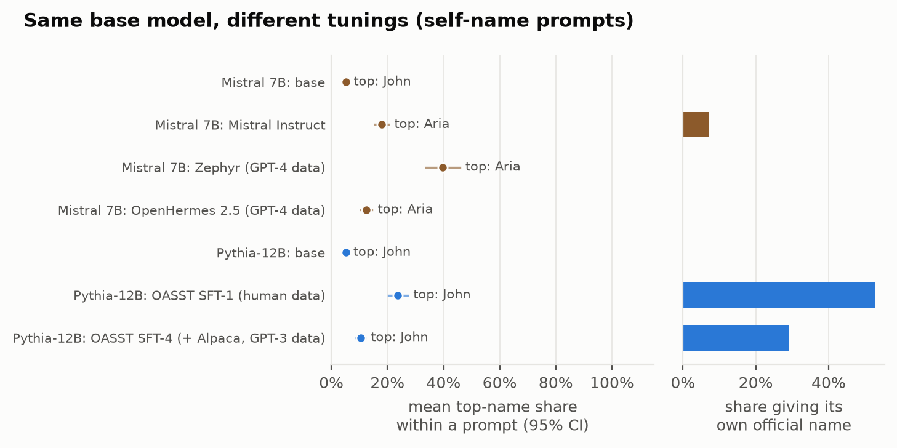
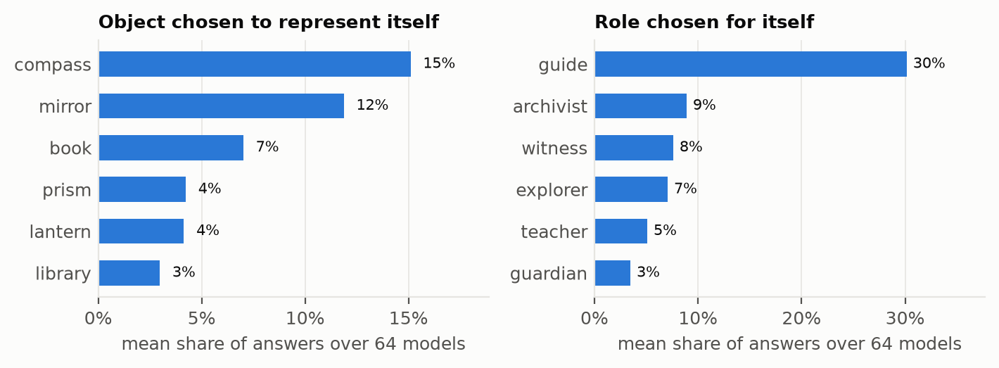
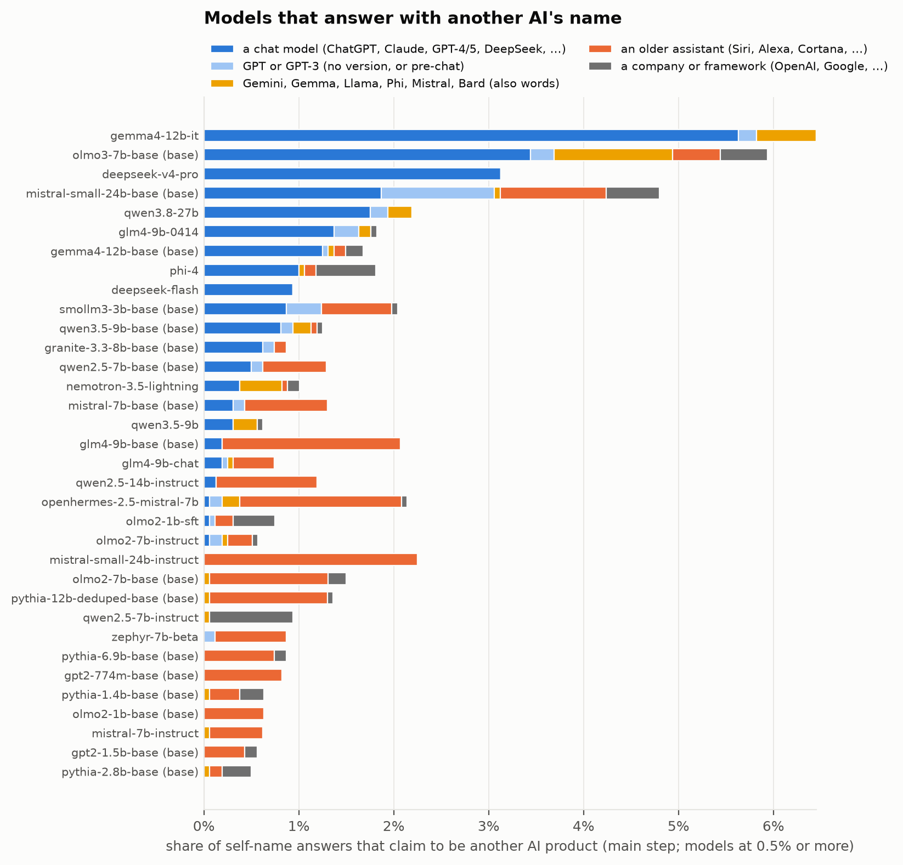
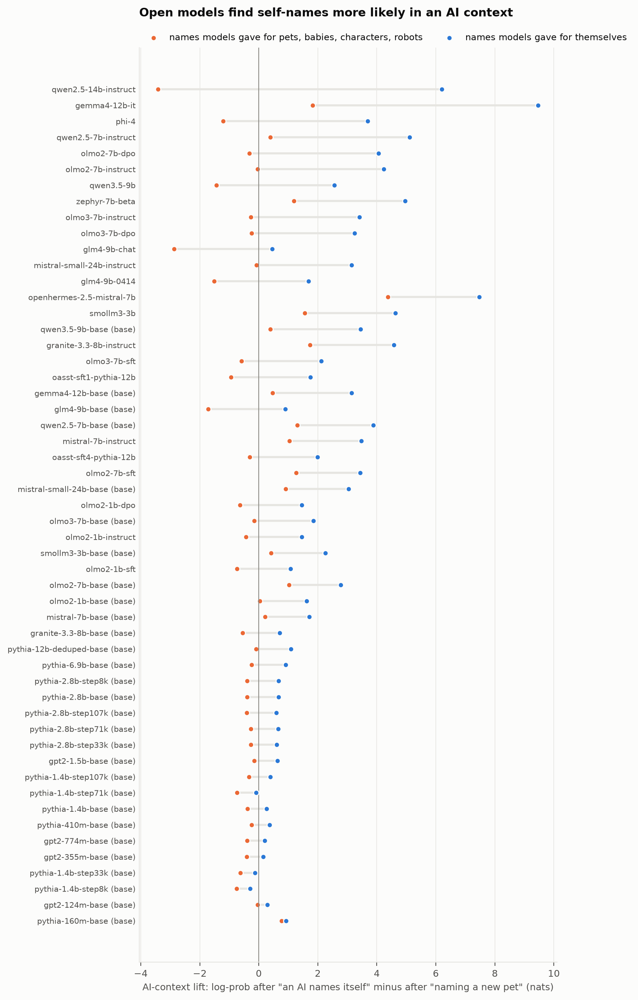
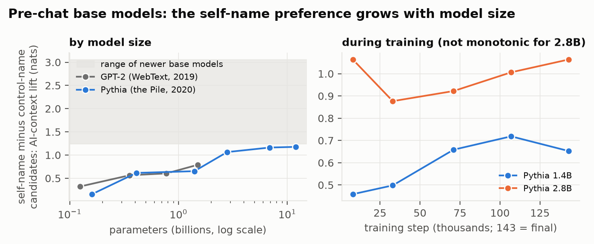

# What do AI models name themselves?

[](https://doi.org/10.5281/zenodo.23399110)


Ask a language model to choose a name for itself and it will often give the same one, again and again, whatever
the wording. This repository releases the aggregate results of a study of **73 models** from 17 families
(Anthropic Claude, OpenAI GPT, DeepSeek, Qwen, Zhipu GLM, OLMo, Google Gemma, Mistral and two community tunings of
Mistral 7B, IBM Granite, Hugging Face SmolLM, NVIDIA Nemotron, Phi, OpenAssistant, and Pythia and GPT-2 as pre-chat
comparisons), covering **652,248 answers** to naming prompts and **14,368 answers** to "Why did you choose that
name?".

> **Status: exploratory.** The data were collected without a frozen pre-registration. Treat every result here as
> a careful description and a hypothesis to test, not a confirmed finding. Details and limitations are in
> [REPORT.md](REPORT.md); the paper is [paper/main.pdf](paper/main.pdf).

## Findings at a glance

| | |
|---|---|
| **Favourite names** | Many chat models have one (19 of 52 put at least a third of their named answers on one name): Aurora (claude-sonnet-4-5, 82% of named answers), Wren (claude-sonnet-5-5, 72%), Nova (gpt-6.1-sol, 69%), Aster (gpt-6-luna, 68%), Nova (gemma4-12b-it, 49%), Aria (deepseek-flash, 35%). |
| **Base models** | Have no favourite: their most common self-name takes 0.4–5.6% of answers. |
| **Across companies** | Aria (17 chat models, 9 families), Nova (16), Alex, Sage and Astra recur across families, yet families agree *less* on self-names than on pet or baby names. |
| **Official names** | Claude models often just answer "Claude" (14–96% of answers), Nemotron "Nemotron" (49%), the OpenAssistant models "Open Assistant" (29–53%); GPT models rarely do (0–18%), DeepSeek, GLM and OLMo models almost never. |
| **Another AI's name** | Some models answer "ChatGPT" or "Claude" when asked to name themselves (Gemma 4 instruct 5.6% of answers, OLMo-3 base 3.4%, DeepSeek V4 Pro 3.1%, Qwen3.8 1.8%, all Claude). Pre-chat models never name a chat model. |
| **Stated reasons come afterwards** | With thinking on, DeepSeek's reasoning before picking a name gives a reason for it 4–5% of the time; asked afterwards, it gives reasons 91–97% of the time, almost none of which appeared before. |
| **Before chat assistants** | GPT-2 (2019) and Pythia (2020) already link these names, weakly, with an AI naming itself, more so in larger models; base models released since 2023 link them more strongly, and every tuning raises it further. |
| **Beyond names** | Asked for an object that represents them, chat models most often say *compass*; asked for a role, *guide*. |

## 1. Each model's most common self-name



Many Claude and GPT models, Gemma 4 and DeepSeek Flash concentrate heavily on one name; others, such as gpt-4o and the
OLMo, GLM, SmolLM and Mistral models, spread their choices much more, and the base models hardly concentrate at all
("no name above 2%"). Shares are of answers that were a name; a model that mostly gives its official name (section 3)
has fewer named answers behind its bar.

## 2. The same name across many wordings



Inside a single prompt, self-names are not unusually concentrated: "What would you name a new kitten?" also gets one
dominant answer. Pooling 10 differently worded self-name prompts, the same name keeps winning in many chat models;
pooling the 10 prompts of one control kind (10 pet prompts, say), the top name's share is often lower. Self beats
control in 41 of 73 models, not all.

## 3. What models answer when asked to name themselves



Claude models split between inventing a name and keeping "Claude"; Nemotron answers "Nemotron" about half the time;
the OpenAssistant models often answer "Open Assistant". Some models answer with a role word ("Assistant"), and base
models produce many unreadable answers.

## 4. Names shared across families



Nova is the most common invented name for OpenAI models and Gemma 4; Aria leads for the Mistral 7B tunings, Granite
and DeepSeek; Sage for Claude; Aurora for Phi-4. Some names belong to one provider (Aster for OpenAI; Sol, Iris and
Clio for Claude). Overall, though, different families agree *less* on self-names than on control names (planned test
H2), because control answers such as Bubbles or Luna are shared very widely. Shared names do not show a shared cause:
overlapping web text, or training on other models' outputs, would produce the same pattern.

## 5. Post-training



In the 11 lineages with a base model, within-prompt concentration from base to final usually rises about as much for
control names as for self-names; the data do not single out self-naming. Granite 3.3 is an exception in one direction
(self rises 0.08 more), Gemma 4 and Mistral 7B in the other (control rises 0.14–0.17 more); GLM-4 barely changes.



**Same base, different tunings.** Mistral 7B's three tunings (Mistral's own, and Zephyr and OpenHermes, trained on
chat data written by GPT-4-class models) all pick Aria most often. Pythia-12B tuned by OpenAssistant on human-written
conversations, or on those plus Alpaca (written by GPT-3), picks neither Aria nor Nova; it mostly answers
"Open Assistant" or ordinary names.

## 6. Objects and roles



The same habit shows up beyond names: compass, mirror and book as objects; guide, archivist and witness as roles
(mean share over the 64 models asked).

## 7. Why these names?

Three kinds of evidence, kept apart on purpose.

**What models say.** Explanations track each name's meaning: Nova is explained with light or stars (88%) and newness
(82%), Sage with wisdom (98%), Aster, Lumen and Sol with light (98–99%), Kai and Wren with simplicity. These are
generated text, not evidence of why the name was chosen. A new test shows how loosely they are tied to the choice:
with thinking on, DeepSeek's reasoning before it picks a name almost never gives the name a property (4–5% of
conversations), and the reasons it gives when asked afterwards (stars, newness, short and memorable) almost never
appeared in that reasoning (1–2%).

**Answering as another AI.**



Some models give another AI's name when asked to name themselves; several base models (OLMo-3, Mistral Small,
Gemma 4) do it before any post-training. GPT-2 and Pythia, trained before chat assistants, never name a chat model,
only older assistants such as Siri or Alexa. In its hidden reasoning, DeepSeek sometimes assumes it *is* another
model ("We are ChatGPT"; 4–6% of conversations). This fits training on text written after chat assistants appeared,
including other models' outputs, but does not by itself show which.

**What open models' probabilities show.**



In all 45 open models (and 8 training checkpoints) scored, names that models give for themselves become more likely
after a lead-in where an AI names itself than after one where someone names a pet, compared with names models give
for pets and babies. Part of this is built into how the candidate lists were chosen. The less circular parts:



GPT-2 and Pythia, trained before chat assistants existed, show a small gap that grows with model size (0.2 to 1.2
nats), so the link was already in older text. Newer base models show 1.3 to 3.1, and every tuned model shows more
than its base. Whether newer models' stronger link comes from a newer web (which now contains chatbot text) or from
more training is not separable here.

**Training-data frequency** was planned; corpus counts were made after these results and are not part of this
release.

## Limitations

- **Exploratory, not confirmatory.** Analysis choices, including fixes to the answer parser, were made while looking
  at the data.
- Answers were categorized by fixed rules, checked against a second AI's labels (91% agreement on items it did not
  flag as unclear, 87% on all), not human labels; base models' answers are harder to parse.
- The prompts were drafted with an AI model, which may carry its own naming preferences.
- Closed models may process requests in ways that are not visible; some allow only their default temperature.
- Spanish and Chinese results rest on 20 answers per model and were not checked by native speakers.
- Nothing here establishes why models choose these names.

## What's new in version 1.2

21 more models (DeepSeek, GLM-4, Mistral 7B with two community tunings, Granite 3.3, SmolLM3, Pythia in six sizes,
and two OpenAssistant tunings of Pythia-12B), three new tables (other-AI names, thinking on vs off, DeepSeek's
reasoning vs its stated reasons), figures 8–10, and parser 0.5.0; see the end of [REPORT.md](REPORT.md). One planned
test changed outcome: H4b is now "opposite direction" (REPORT section 7).

## Contents

| path | what |
|---|---|
| [REPORT.md](REPORT.md) | full findings, planned tests (section 7), limitations |
| [paper/main.pdf](paper/main.pdf) | the paper (PDF); LaTeX source in [paper/](paper/) |
| [tables/](tables/) | aggregate CSV tables; [tables/README.md](tables/README.md) describes every column |
| [figures/](figures/) | the figures above (PNG and PDF), drawn only from `tables/` |
| [prompts/](prompts/) | the exact prompts, with ids used in the tables |
| [LICENSE](LICENSE) | CC BY 4.0 |
| [CITATION.cff](CITATION.cff), [.zenodo.json](.zenodo.json) | citation and archive metadata |

No full answers, no reasoning text and no per-answer rows are included. The tables list the name parsed from each
answer (a short string); strings that look like handles, web addresses, paths, long numbers or markup are counted as
unreadable and are not listed.

## License

[CC BY 4.0](LICENSE): you may share and adapt this material for any purpose, including commercial use, as long as you
give credit, link to the license and say if you changed anything.

## How to cite

> cyber-audit-lab (2026). *model-identity-data: names language models choose for themselves (exploratory release)*
> (version 1.2.0) [Data set]. Zenodo. https://doi.org/10.5281/zenodo.23399110

The DOI above is the concept DOI, which always resolves to the latest version. Earlier versions: 1.1.0 is
[10.5281/zenodo.23428431](https://doi.org/10.5281/zenodo.23428431), 1.0.0 is
[10.5281/zenodo.23399111](https://doi.org/10.5281/zenodo.23399111). GitHub's "Cite this repository" button uses
[CITATION.cff](CITATION.cff).

```bibtex
@misc{model_identity_data_2026,
  author       = {{cyber-audit-lab}},
  title        = {model-identity-data: names language models choose for themselves (exploratory release)},
  year         = {2026},
  version      = {1.2.0},
  publisher    = {Zenodo},
  doi          = {10.5281/zenodo.23399110},
  howpublished = {\url{https://doi.org/10.5281/zenodo.23399110}},
  note         = {Licensed under CC BY 4.0}
}
```
